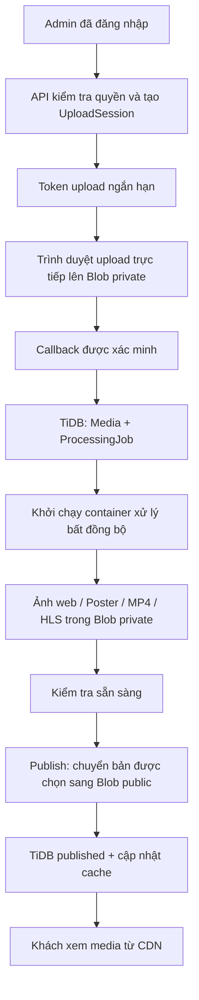

# Kế hoạch triển khai portfolio media

Ngày lập: 24/11/2026. Trạng thái: đề xuất để duyệt thiết kế, chưa triển khai ứng dụng production.

## 1. Mục tiêu và giả định

Website giúp khách hàng xem tác phẩm, hiểu chính xác phần việc chủ portfolio đã thực hiện và gửi yêu cầu hợp tác. Ưu tiên trải nghiệm ảnh và phim trên điện thoại; trang quản trị cho phép tự cập nhật nội dung mà không sửa code.

Giả định để lập kế hoạch: một chủ portfolio, một tài khoản quản trị, nội dung tiếng Việt, khoảng 20–50 dự án ban đầu. Tên studio, tên dự án và hình minh họa trong bản phác thảo là dữ liệu mẫu. Chưa có thông tin thương hiệu, tác phẩm thật, ngân sách lưu trữ và lượng người truy cập. Không sử dụng những số liệu thành tích hoặc logo khách hàng chưa được xác nhận.

Ảnh tham khảo chỉ được dùng làm định hướng thẩm mỹ: nền sáng bạc, kính mờ, góc bo mềm, điểm nhấn tím, chữ đen, nút CTA tối. Nội dung và các thành phần trong ảnh không phải yêu cầu chức năng.

## 2. Hướng thiết kế: Luminous Frame

- Nền #ECECF2, panel #F8F8FC, chữ chính #171821, chữ phụ #616471; accent #8B5CF6 / xanh tím #858BEB. Nội dung chữ không dùng tím nhạt nếu thiếu tương phản.
- Sans hỗ trợ đầy đủ tiếng Việt, ví dụ Be Vietnam Pro. Tiêu đề desktop 56–72px, mobile 36–44px; body 16–18px; phụ đề tối thiểu 12–14px.
- Khung nội dung tối đa khoảng 1280px; grid desktop 12 cột, gutter 24px; mobile lề 20px, một cột. Bo góc 20–28px, bóng rất nhẹ; hạn chế backdrop blur ở thanh điều hướng và các lớp nhỏ.
- Trên khoảng 50–65% diện tích nội dung đầu trang dành cho media. Ảnh giữ màu tác phẩm, không phủ tím lên ảnh thật. Khung xem chi tiết có chế độ nền tối để đánh giá tác phẩm.
- Motion 160–240ms cho hover, 300–450ms cho chuyển vùng. Không tự phát nhiều video, không scroll hijack, không con trỏ tùy biến. Có chế độ reduced motion.
- Card video có biểu tượng phát, thời lượng và vai trò; card ảnh có số ảnh hoặc thể loại. Hiệu ứng hover không chứa thông tin thiết yếu.

## 3. Cấu trúc trang công khai

| URL | Nội dung | Hành động chính |
| --- | --- | --- |
| `/` | Hero, dự án tuyển chọn, giới thiệu ngắn, dịch vụ, quy trình, liên hệ | Xem dự án / xem showreel |
| `/work` | Tất cả dự án, lọc Ảnh / Video / Kết hợp; tag, phân trang | Mở một dự án |
| `/work/[slug]` | Tác phẩm, bối cảnh, vai trò, phạm vi đóng góp, credits, dự án tiếp theo | Xem ảnh lớn / phát phim / liên hệ |
| `/about` | Giới thiệu, chuyên môn, cách làm việc; khách hàng đã được phép công bố | Liên hệ |
| `/contact` | Form yêu cầu hợp tác, email, mạng xã hội | Gửi brief |
| `/admin/*` | Đăng nhập, dự án, thư viện media, yêu cầu liên hệ, cài đặt | Quản lý nội dung |

### Trang chủ

1. Header kính mờ: thương hiệu, Dự án, Giới thiệu, Liên hệ, CTA Hợp tác. Mobile dùng menu gọn có nhãn rõ ràng.
2. Hero 5/7 cột: bên trái tên + định vị nghề + CTA; bên phải ảnh tác phẩm hoặc poster showreel lớn. Nút xem showreel mở player, chỉ tải video sau khi bấm.
3. Selected work xuất hiện ngay sau hero: 1 dự án chủ đạo rộng và 2–4 dự án phụ; mỗi card ghi loại dự án, tên và vai trò thực tế. Bộ lọc có trạng thái không có kết quả.
4. Giới thiệu ngắn + chân dung/BTS + các kỹ năng hoặc dịch vụ chính. Chỉ thêm thành tích, lời nhận xét, logo khi có dữ liệu thật và quyền sử dụng.
5. Quy trình bốn bước: Brief → Ý tưởng → Sản xuất → Hậu kỳ & bàn giao.
6. CTA cuối trang + email / form ngắn. Footer chứa social và thông tin bản quyền.

### Chi tiết dự án

Tiêu đề, client/năm/thể loại, cover lớn; sau đó là mục tiêu, vai trò cá nhân và phạm vi tham gia. Dự án ảnh dùng các block ảnh rộng / hai ảnh / ảnh dọc với nhịp biên tập; tránh masonry làm sai thứ tự đọc. Dự án video dùng player, poster, phụ đề nếu có, credits, các frame hậu trường. Dự án kết hợp dùng block ảnh và video xen kẽ.

Ảnh mở lightbox hỗ trợ phím trái/phải, Escape, pinch zoom, caption và số thứ tự; giữ nguyên tỉ lệ ảnh, chỉ cắt ở thumbnail theo focal point đã chọn. Tải ảnh lớn hiện tại và tối đa một ảnh lân cận; không tải cả album bản lớn. Cuối trang có dự án trước/sau và CTA liên hệ theo dự án.

### Mobile

Hero xếp chữ trước, media sau. Grid thành một cột hoặc hai thumbnail khi đủ chỗ; không thu nhỏ cả bố cục desktop. Chạm mở dự án, không phụ thuộc hover. Player giữ đúng tỉ lệ; lightbox có nút đóng và điều hướng đủ lớn; menu hỗ trợ keyboard và focus. Contact form dùng input thích hợp, lỗi ngay tại trường.

## 4. Phạm vi chức năng

### Phiên bản đầu

- Đăng nhập quản trị, không mở đăng ký công khai; session an toàn, xác thực quyền trên mọi thao tác ghi.
- Tạo/sửa dự án; draft/published/archived, slug duy nhất, cover, loại dự án, vai trò, client, năm, mô tả, credits, tag và SEO.
- Upload nhiều ảnh hoặc video với tiến độ từng tệp, hủy, retry và thông báo lỗi. Kéo thả để sắp xếp, chọn cover/focal point, nhập alt/caption.
- Thư viện media: xem nơi đang sử dụng, dung lượng, trạng thái xử lý; không xóa cứng tài nguyên còn được tham chiếu.
- Preview có xác thực; chỉ cho xuất bản khi media cần thiết đã READY. Media xử lý lỗi không làm mất phần nội dung đã nhập.
- Quản lý trang giới thiệu, liên kết mạng xã hội và thông tin liên hệ.
- Form liên hệ ghi DB; kiểm tra dữ liệu, chống spam/rate limit. Thông báo email cho chủ site có thể thêm sau khi cấu hình dịch vụ gửi mail.
- Metadata, sitemap, robots, canonical, Open Graph; trang lỗi, loading và empty state.

### Sau khi ra mắt

Song ngữ; album gửi khách có đăng nhập; nhiều cộng tác viên; tìm kiếm nâng cao; tích hợp booking; analytics chi tiết theo dự án. Không đưa các mục này vào thời gian MVP.

## 5. Kiến trúc đề xuất

| Thành phần | Lựa chọn | Trách nhiệm |
| --- | --- | --- |
| Giao diện và backend | Next.js App Router + TypeScript | Server render trang công khai, route handlers cho quản trị/upload |
| Thiết kế | Tailwind CSS + component có accessibility | Token, responsive, form, dialog/lightbox |
| Dữ liệu | Prisma, schema MySQL | Truy vấn có type, migration, validation |
| Local | MySQL của Laragon, xác minh đúng MySQL/MariaDB và version | Dev; kiểm tra migration trên TiDB staging trước production |
| Production DB | TiDB Cloud bản tương thích MySQL | Metadata, dự án, quyền, job, liên hệ |
| Tệp | Vercel Blob private + public | Private: nguồn và draft; public: bản hiển thị đã xuất bản |
| Xử lý media | Container Sharp + FFmpeg, đề xuất Cloud Run Jobs | Màu ảnh, metadata, derivatives, video encode, poster/HLS |
| Deploy | GitHub → Vercel preview / production | CI, review bản preview, deploy ứng dụng |

Trang công khai dùng Server Components và cache nội dung đã xuất bản; chỉ client hóa filter, lightbox, player và form cần tương tác. Invalidate cache theo dự án sau publish/edit/unpublish; không rebuild toàn bộ site sau mỗi upload.

Chọn Node.js runtime cho backend. Kết nối Prisma/TiDB bằng MySQL TCP/TLS, tái sử dụng client và giới hạn pool nhỏ theo hạn mức thực tế; load-test đồng thời trước launch. HTTP driver/Prisma adapter của TiDB là lựa chọn thay thế sau thử nghiệm, tài liệu hiện ghi public preview; không coi là mặc định bắt buộc. Migration vẫn dùng kết nối phù hợp riêng. TiDB tương thích nhiều tính năng MySQL nhưng không tuyệt đối: không thiết kế phụ thuộc trigger/procedure; kiểm thử migration và truy vấn trên TiDB staging. [TiDB connectivity](https://docs.pingcap.com/developer/dev-guide-connect-to-tidb/), [connection pools](https://docs.pingcap.com/developer/dev-guide-connection-parameters/).

Đặt vùng ứng dụng, Blob và worker gần nhóm người xem chính tại Việt Nam/Đông Nam Á theo dịch vụ cung cấp, đo thực tế rồi chốt; DB gần backend để giảm độ trễ truy vấn. CDN phân phối bản media công khai. DB chỉ lưu key/URL và metadata, không lưu bytes ảnh/video.

### Luồng media

Worker đọc nguồn private bằng credential hạn chế, ghi output và báo trạng thái qua API nội bộ có xác thực. Tách môi trường staging/production; không nhúng token Blob hoặc DB credential vào frontend. Tín hiệu callback và job được xử lý idempotent theo uploadSessionId/mediaVersion. Job có lease, timeout, retry có backoff và giới hạn lần thử; tác vụ đối soát theo lịch tìm job treo/tệp mồ côi. Không chỉ dựa vào lời báo hoàn tất từ trình duyệt.

## 6. Upload và quản lý tệp lớn

1. Admin chọn tệp, frontend kiểm tra sơ bộ loại, kích thước, quota.
2. API xác thực session và quyền dự án; tạo đường dẫn random theo môi trường, project, mediaId và version. Token bị giới hạn loại tệp/kích thước, không dùng token store dài hạn trên client.
3. Browser → Blob trực tiếp, bật multipart cho tệp lớn; UI có % tiến độ, retry và cancel. Không hứa resume sau khi đóng tab nếu chưa xây dựng cơ chế lưu phiên multipart riêng.
4. Callback xác minh liên kết UploadSession, key, size và trạng thái. Worker kiểm tra signature thực của file, codec, kích thước và thời lượng, không chỉ tin extension/MIME gửi từ client.
5. Tạo bản hiển thị, ghi trạng thái READY hoặc FAILED. Chỉ xuất bản khi output hợp lệ.

Hạn mức sản phẩm khởi điểm để thảo luận: ảnh nguồn JPEG/PNG/WebP/HEIC tối đa 50 MB/tệp; video tối đa 2 GB/tệp. Đây là đề xuất của ứng dụng, phải đối chiếu hạn mức gói và đo worker trước khi áp dụng. HEIC chỉ mở khi container giải mã được; RAW, PSD, project Premiere không là định dạng xuất bản web. Giới hạn theo dự án/tổng kho để kiểm soát chi phí.

Vercel Function giới hạn payload request/response 4.5 MB, vì vậy API chỉ cấp quyền và xử lý metadata, không proxy toàn bộ upload. Multipart hỗ trợ chia phần và thử lại phần lỗi. [Vercel upload guidance](https://vercel.com/kb/guide/how-to-bypass-vercel-body-size-limit-serverless-functions), [Blob multipart SDK](https://vercel.com/docs/vercel-blob/using-blob-sdk).

## 7. Ảnh: chất lượng cao và tải nhanh

Không ép mọi ảnh cùng một dung lượng. Giữ nguyên bản gốc riêng tư để có thể tạo lại output; hiển thị bản phù hợp kích thước màn hình và ngữ cảnh, bảo toàn tỉ lệ, chi tiết và màu.

- Worker sửa orientation, chuyển profile nguồn sang sRGB cho bản web, xóa EXIF/GPS khỏi bản công khai; bản nguồn vẫn giữ nguyên. Không upscale ảnh nhỏ. Kiểm thử ảnh da người, màu tối, gradient, ảnh hạt film và ảnh có chữ.
- Tạo web master chất lượng cao, cạnh dài tối đa khoảng 3200px, JPEG q92 hoặc PNG khi cần lossless/alpha; đặt private trước publish. Output lớn hơn chỉ khi có nhu cầu zoom thật.
- Grid và hero: dùng `next/image` từ web master public, khai báo width/height hoặc aspect-ratio, `sizes`, remotePatterns đúng hostname. Allowlist quality ban đầu 80/85/90; mặc định 85 cho tác phẩm. Benchmark WebP trước; bật AVIF nếu lợi ích dung lượng bù được thời gian encode và chi phí cache.
- Không nén mạnh hai lần: master chất lượng cao → một bước tối ưu delivery. Các derivative đặc biệt được worker tạo sẵn, như ảnh lightbox 1600/2560/3200px, sẽ đi trực tiếp qua `<picture>`/`img srcset` và không lại qua Image Optimization.
- Hero/LCP chỉ ưu tiên một ảnh, không lazy load nó. Phần dưới lazy load; dùng blur placeholder rất nhỏ và giữ sẵn kích thước để tránh nhảy layout.
- Lightbox tải bản lớn khi mở, chọn chiều rộng theo viewport/DPR và trần tài nguyên; chỉ tải thêm kích thước cao hơn khi zoom. Không ép điện thoại tải ảnh nguồn 30 MB.
- Tên file có version/hash, cache lâu cho tài nguyên bất biến; thay media tạo URL mới. Hạn chế số size/quality để không tạo ma trận biến thể vô hạn.
- Không phát tán bản gốc qua nút download mặc định. Nếu cần tải file gốc, đó là một chức năng riêng có phân quyền.

Ngân sách thử nghiệm, không phải cam kết cho mọi ảnh: thumbnail 80–200 KB; card 150–350 KB; hero 250–600 KB; lightbox 400 KB–1.5 MB. Nếu ảnh nhiều chi tiết không đạt độ đẹp ở mức này, cho tăng dung lượng có kiểm soát và giảm số ảnh tải đồng thời.

Next.js hỗ trợ responsive image, quality và thương lượng định dạng; AVIF có chi phí encode/cache khác WebP. Cấu hình phiên bản framework sẽ được khóa khi khởi tạo. [Next.js Image](https://nextjs.org/docs/app/api-reference/components/image).

## 8. Video: cần pipeline riêng

Blob cung cấp object storage và range request để đọc từng phần, nhưng thiết kế này không giả định Blob tự transcode hoặc tự tạo adaptive streaming. Container FFmpeg đảm nhiệm encode, Blob lưu và phân phối đầu ra. [Blob overview](https://vercel.com/docs/vercel-blob), [range requests](https://vercel.com/docs/vercel-blob/examples).

- Lưu bản xuất nguồn chất lượng cao private; không yêu cầu upload footage camera/RAW hàng trăm GB lên portfolio.
- Tạo poster do admin chọn, thumbnail và metadata. Poster tải trước, video `preload="none"`; khi bấm mới gắn nguồn player. Nút phát có nhãn, controls đầy đủ.
- Video ngắn: MP4 H.264 + AAC, `faststart`, tương thích rộng; có thể tạo WebM nếu kiểm thử thấy cần. Dùng chất lượng theo nội dung, không một bitrate cho mọi phim.
- Video dài hoặc nặng: tạo HLS nhiều mức 480p/720p/1080p, thêm 1440p/2160p khi nguồn và nhu cầu cho phép, không upscale. Apple Safari dùng HLS native; trình duyệt khác tải hls.js khi cần; có MP4 fallback.
- Đề xuất chuyển HLS khi video dài trên khoảng 60 giây hoặc bản phát vượt khoảng 30–50 MB; quyết định cuối qua thử nghiệm. MVP phải có HLS nếu tác phẩm thật rơi vào nhóm này.
- Tạo cấu trúc manifest/segment theo mediaVersion; đường dẫn, MIME, cache và CORS cần được kiểm tra trên Blob. Publish nguyên bộ trước khi gắn vào dự án để tránh manifest trỏ đến segment thiếu.
- 4K chỉ tải theo lựa chọn hoặc điều kiện phù hợp; mặc định Auto dùng rendition vừa đường truyền. Không tự phát có âm thanh. Nếu cần hero loop, dùng clip riêng ngắn 5–8 giây, muted/playsinline, ngừng ngoài màn hình, tôn trọng data saver/reduced motion; poster là mặc định trên mobile.
- Chuyển HDR sang SDR có tone map và duyệt màu riêng; không chỉ bỏ metadata HDR. Nếu muốn phát HDR gốc cần nhánh kỹ thuật khác.
- Caption WebVTT nếu có hội thoại, credits và quyền dùng âm nhạc/tác phẩm do chủ site xác nhận.

Worker video chạy bất đồng bộ trong container được cấp tài nguyên phù hợp; không encode phim trong request upload hoặc lúc khách mở trang. Có retry, timeout, log lỗi và chi phí theo job. Nếu vận hành encode tự quản không phù hợp ngân sách, có thể cân nhắc dịch vụ video chuyên dụng ở giai đoạn sau; không tự ý thêm vào stack đã chốt.

Cloud Run Jobs là phương án đề xuất để thực thi container đến khi tác vụ hoàn tất; cấu hình CPU, RAM, timeout, số retry và credential được khóa sau thử nghiệm một phim thật. Đây là dịch vụ bổ sung cho khâu xử lý, còn website vẫn deploy trên Vercel và tài nguyên vẫn lưu ở Blob. [Cloud Run Jobs](https://docs.cloud.google.com/run/docs/create-jobs).

## 9. Mô hình dữ liệu

| Bảng | Trường chính |
| --- | --- |
| User / Session | id, email, authIdentity, role, session expiry |
| Project | id, slug unique, title, type, status, client, year, summary, role, scope, coverMediaId, featuredOrder, publishedAt, seo fields |
| Media | id, sourceKey, mime, bytes, width, height, duration, checksum, version, status, error |
| MediaVariant | mediaId, version, kind, key/url, access, width, height, codec, bytes; HLS manifest liên kết prefix segment |
| ProjectMedia | projectId, mediaId, sortOrder, layout, alt, caption, focalX, focalY |
| Tag / ProjectTag | tag slug/name và quan hệ nhiều-nhiều |
| UploadSession | id, userId, projectId, expectedKey, limits, expiresAt, completedAt |
| ProcessingJob | id, mediaId, version, state, attempts, leaseUntil, error, startedAt, finishedAt |
| Inquiry | id, name, email, brief, projectType, status, createdAt |
| SiteSettings / AuditLog | nội dung site; hành động publish/delete/admin |

Index: Project(slug), Project(status,publishedAt), Project(status,featuredOrder), ProjectMedia(projectId,sortOrder), ProcessingJob(state,leaseUntil), Inquiry(status,createdAt). Quan hệ Media và Project đi qua ProjectMedia để tái sử dụng tài nguyên; duy trì toàn vẹn khi xóa. Structured credits/content được validate theo schema ứng dụng, không dùng HTML tùy ý chưa sanitize.

## 10. An toàn dữ liệu và vận hành

- Xác thực tất cả endpoint admin và upload token; kiểm tra quyền theo project. Chống CSRF cho mutation theo cơ chế auth; cookie HttpOnly/Secure/SameSite phù hợp.
- Secret chỉ ở server/Vercel env/worker secret manager, không commit `.env`, file nguồn hoặc dump DB vào Git.
- Bản nguồn và draft private; preview chỉ có thể xem sau xác thực. Bản đã public có URL công khai: unpublish gỡ khỏi site và xóa output công khai, nhưng không hứa thu hồi ngay mọi bản cache hoặc bản người khác đã tải.
- Giới hạn upload theo tài khoản/ngày/kho; kiểm tra magic bytes, kích thước pixel, duration và tài nguyên giải mã để tránh tệp bất thường. Không cho phép SVG/script tùy ý trong pipeline ảnh công khai.
- Ghi log lỗi có mã media/job, không log token hoặc thông tin nhạy cảm. Cảnh báo dung lượng, transfer, processing failure, lỗi player, DB latency.
- Xóa hai giai đoạn: kiểm tra reference → đánh dấu chờ xóa → hết thời gian khôi phục mới xóa variants/source. Tác vụ cleanup không tự xóa nguồn chưa xác định rõ sở hữu.
- Chính sách backup DB theo gói TiDB, thêm export metadata định kỳ; nguồn media có bản sao độc lập ngoài Blob. Git và snapshot code không thay thế backup media. Thử khôi phục một dự án trước launch.
- Form lưu thông tin tối thiểu cần thiết; có thông báo quyền riêng tư và chính sách lưu/xóa yêu cầu liên hệ.

## 11. Git, môi trường và triển khai

1. Khởi tạo repo, Next.js/TypeScript, cấu hình lint/typecheck/build, `.env.example`, `.gitignore`. Media không đưa vào Git.
2. Development: MySQL local, Blob development tách riêng; callback cần URL tunnel hoặc dùng staging để kiểm tra toàn bộ vòng upload. [Blob client uploads](https://vercel.com/docs/vercel-blob/client-upload).
3. Preview: branch/PR tạo Vercel preview, dùng DB/Blob staging và auth test; không ghi DB production từ preview.
4. CI kiểm tra code/build, kiểm thử phần quyền, publish/upload/job. Migration production chạy trong một bước có kiểm soát trước release, không chạy đua từ mọi preview build.
5. Production: env riêng, domain/HTTPS, migration, seed admin, import các dự án đầu, warm/test các media quan trọng.
6. Rollback code bằng deployment trước; schema dùng migration tương thích ngược theo expand/contract. Rollback code không tự rollback DB hoặc tệp; lưu version nội dung/media cần phục hồi.

## 12. Lộ trình và điều kiện nghiệm thu

Ước lượng cho một lập trình viên toàn thời gian, nội dung được cung cấp kịp và một vòng duyệt chính: 22–30 ngày làm việc, khoảng 4–6 tuần. Có thể dài hơn nếu album lớn, nhiều video HDR/4K, chuyển dữ liệu cũ hoặc yêu cầu song ngữ. Mốc là ước lượng công việc, chưa phải lịch cam kết.

| Giai đoạn | Thời lượng | Đầu ra / điều kiện qua mốc |
| --- | --- | --- |
| Chốt brief và thiết kế | 3–4 ngày | Duyệt homepage desktop/mobile, project ảnh/video, admin upload; chốt tác phẩm mẫu và giới hạn tệp |
| Nền tảng, DB, auth, môi trường | 3–4 ngày | Deploy preview; migration chạy local + TiDB staging; quyền admin hoạt động |
| Trang công khai và case study | 4–5 ngày | Responsive; gallery/lightbox/player bằng nội dung thật; SEO và trạng thái rỗng/lỗi |
| CMS, direct upload, pipeline | 7–10 ngày | Tự thêm dự án; xử lý ảnh, MP4/HLS; retry job; private draft; publish/cache hoạt động |
| QA, hiệu năng, nội dung, launch | 5–7 ngày | Kiểm thử thiết bị/mạng, khôi phục, cảnh báo, tài liệu quản trị, domain production |

Điểm duyệt thiết kế gồm: hướng sáng tím này, mật độ gallery, mức độ dùng video trong hero, cách thể hiện vai trò cá nhân, nội dung chân dung/brand. Bản phác thảo hiện tập trung vào trang chủ, chi tiết một dự án và quản trị media; ảnh thật sẽ được đặt sau khi có nội dung.

### Kiểm thử phải có

- Luồng chính: login → tạo draft → upload → xử lý → sắp xếp → preview → publish → khách xem → unpublish.
- Media: ảnh dọc/ngang/rất lớn/EXIF rotation/HEIC nếu bật; video ngắn/dài/HDR nếu nhận; không upscale; filename unicode/trùng; mất mạng, hủy upload, callback trùng, worker lỗi, job timeout, quota đầy.
- Bảo mật: khách không thể tạo token hoặc sửa dự án; draft/source không truy cập công khai; MIME giả bị từ chối; form rate limit; preview không ghi production.
- Thiết bị: Chrome, Safari iOS, Android Chrome; ảnh hiển thị tốt, video tua/phát/dừng, HLS Auto/fallback, caption, fullscreen.
- Accessibility: tab/focus, nhãn controls, Escape và trả focus khi đóng lightbox, màu tương phản, reduced motion; layout 360/390/768/1440px.
- Đồng thời: hai lần publish, job callback đến trễ, xóa media đang dùng; không ghi đè version mới hoặc tạo dự án published thiếu file.

### Mục tiêu hiệu năng

Core Web Vitals tại phân vị 75 sau khi có đủ traffic: LCP ≤2.5s, INP ≤200ms, CLS ≤0.1. Trước launch dùng lab profile mobile 4G đại diện Việt Nam, cold/warm cache và đo thực tế; không gọi số lab là kết quả field.

Ngân sách ban đầu: payload trang đầu khoảng ≤1.5–2 MB, chưa tính video người dùng chủ động phát; JS client nén khoảng ≤200 KB làm mốc điều tra, không phải giới hạn cứng. Chỉ ưu tiên ảnh LCP; các album lớn phân lô; không tải hàng chục ảnh lớn/player lúc khởi động. Lighthouse là công cụ hỗ trợ chẩn đoán, không thay thế kiểm tra hình và video thực.

## 13. Chi phí và việc cần chốt

Chưa có đủ dữ liệu để báo tiền tháng đáng tin cậy. Trước khi chọn gói, đo dung lượng nguồn + output, transfer ảnh/video, số phép tối ưu ảnh, DB request/storage, encode minutes/CPU và job retry. Không giả định dịch vụ luôn miễn phí; đối chiếu điều kiện và giá chính thức tại thời điểm deploy.

Ví dụ cách ước lượng: 1.000 lượt phát trung bình 60 giây ở 4 Mb/s tương đương khoảng 30 GB dữ liệu video, chưa gồm overhead/CDN; HLS thay đổi lượng tải theo chất lượng và thời lượng xem thực. Dung lượng lưu có thể nhiều lần bản phát chính vì có source, poster, rendition và các version. Đặt budget alert và quota trước launch.

Cần người dùng chốt ở vòng duyệt: tên/định vị thương hiệu; 6–10 dự án đại diện và vai trò; tỷ trọng ảnh/video, độ dài và nguồn 4K/HDR; ngôn ngữ; email/social; quyền công bố; ngân sách hạ tầng. Những thông tin này không ngăn việc duyệt hướng layout hiện tại.

## 14. Thứ tự triển khai sau duyệt

Chốt giao diện → thử nghiệm pipeline với một album và một phim thật → khóa cấu hình chất lượng/chi phí → xây dữ liệu/auth/CMS → hoàn thiện trang công khai → nhập nội dung → QA và release. Thử media sớm để không đến cuối dự án mới phát hiện màu ảnh, codec hoặc chi phí không đạt kỳ vọng.
